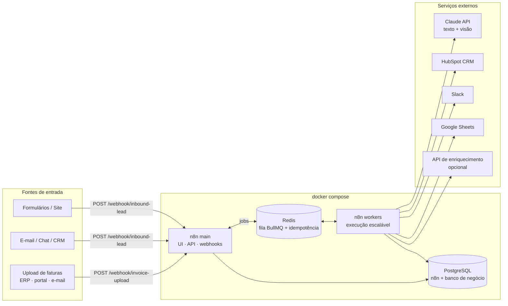
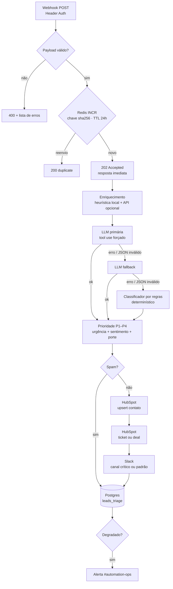
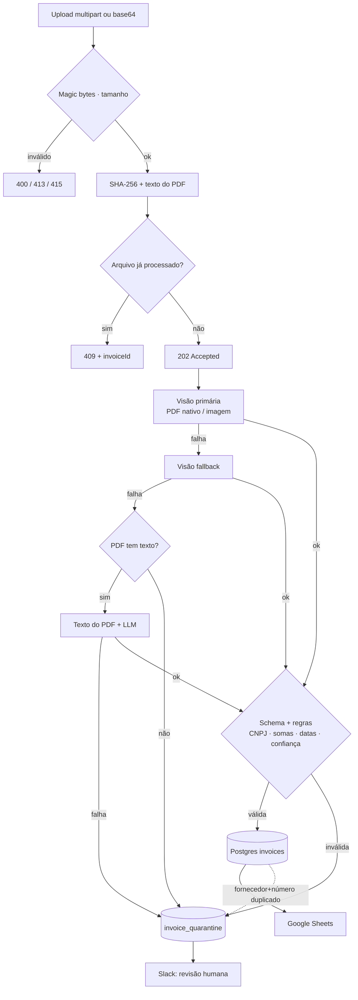
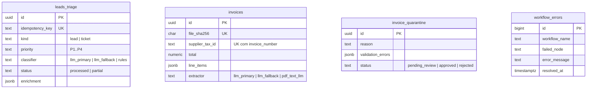

# Enterprise AI Automation Suite

> Dois workflows n8n de nível produção que conectam LLMs a processos de negócio reais — **triagem inteligente de leads/tickets** e **extração de faturas** — com idempotência, validação de schema, fallback em 3 níveis e trilha de auditoria. Sobe localmente com um único comando.


| | Fluxo A — Triagem de Inbound | Fluxo B — Extração de Faturas |
|---|---|---|
| **Entrada** | Webhook (formulário, e-mail, chat, CRM) | Upload de PDF/imagem (multipart ou base64) |
| **IA** | Sentimento, urgência, categoria, resumo e resposta sugerida | Leitura multimodal de PDF/imagem → JSON estruturado |
| **Saída** | HubSpot (contato + ticket/deal), Slack, Postgres | Postgres, Google Sheets, fila de revisão no Slack |
| **Se a LLM falhar** | LLM fallback → classificador por regras | Visão fallback → texto do PDF + LLM → quarentena |

---

## Sumário

1. [Impacto de negócio e ROI](#1-impacto-de-negócio-e-roi)
2. [Arquitetura](#2-arquitetura)
3. [Robustez: erros e fallbacks](#3-robustez-erros-e-fallbacks)
4. [Quickstart](#4-quickstart)
5. [Guia de importação e configuração](#5-guia-de-importação-e-configuração)
6. [Testando os fluxos](#6-testando-os-fluxos)
7. [Variáveis de ambiente](#7-variáveis-de-ambiente)
8. [Observabilidade](#8-observabilidade)
9. [Desenvolvimento](#9-desenvolvimento)
10. [Segurança](#10-segurança)
11. [Limitações conhecidas e roadmap](#11-limitações-conhecidas-e-roadmap)

---

## 1. Impacto de negócio e ROI

### Resultado: **economia estimada de 15 horas semanais por analista**

O cálculo considera um analista de operações que divide o tempo entre atendimento/qualificação de entrada e contas a pagar. As premissas são conservadoras e **parametrizáveis** — troque pelos números da sua operação.

#### Fluxo A — Triagem de leads/tickets

| Etapa manual | Antes (min/item) | Depois (min/item) |
|---|---:|---:|
| Ler e entender a mensagem | 1,5 | — (resumo pronto) |
| Pesquisar empresa/contato | 1,5 | — (enriquecimento automático) |
| Classificar urgência e encaminhar | 0,5 | — (prioridade P1–P4 + canal certo) |
| Cadastrar contato e ticket/deal no CRM | 1,5 | — (HubSpot automático) |
| Redigir a primeira resposta | 0,5 | 1,5 (revisar resposta sugerida + resumo) |
| **Total** | **5,5** | **1,5** |

**Economia:** 4 min × 27 itens/dia × 5 dias = 540 min = **9 h/semana**

#### Fluxo B — Lançamento de faturas

| Etapa manual | Antes (min/fatura) | Depois (min/fatura) |
|---|---:|---:|
| Digitar cabeçalho e itens | 3,0 | — (extração multimodal) |
| Conferir CNPJ, somas e datas | 1,0 | — (validação automática) |
| Lançar na planilha/sistema | 1,0 | — (Postgres + Sheets) |
| Tratar exceções | — | 1,0 (média, incluindo revisão das ~10–15% em quarentena) |
| **Total** | **5,0** | **1,0** |

**Economia:** 4 min × 90 faturas/semana = 360 min = **6 h/semana**

#### Consolidado por analista

| Métrica | Valor |
|---|---|
| Horas economizadas | **9 h + 6 h = 15 h/semana** (≈ 65 h/mês, ≈ 0,4 FTE) |
| Valor do tempo liberado¹ | 15 h × R$ 55/h = **R$ 825/semana ≈ R$ 3.570/mês** |
| Ganho qualitativo | Tickets P1 chegam ao canal crítico em segundos (antes: até o próximo ciclo de leitura da fila); zero erro de digitação em CNPJ/valores |

¹ *Custo-hora carregado (salário + encargos) de um analista pleno; ajuste para a sua realidade.*

#### Custo operacional e payback

```
Custo mensal  = Infra + (Nₐ × tokens_triagem + N_b × tokens_fatura) × preço_por_token
ROI mensal    = (Horas_economizadas × Custo_hora) − Custo mensal
Payback       = Custo de implantação ÷ ROI mensal
```

| Parâmetro | Estimativa de referência |
|---|---|
| Infra (VPS 2 vCPU / 4 GB para n8n + Postgres + Redis) | custo fixo de uma VM pequena |
| Tokens por triagem | ~1,5–2 k de entrada · ~0,4 k de saída |
| Tokens por fatura (1–2 páginas) | ~3–6 k de entrada · ~1,5 k de saída |
| Volume mensal por analista | ~585 triagens + ~390 faturas |

> Multiplique os tokens pelo preço vigente dos modelos configurados em `LLM_PRIMARY_MODEL` / `LLM_FALLBACK_MODEL` ([tabela oficial](https://www.anthropic.com/pricing)). A taxa de uso do fallback (ver [Observabilidade](#8-observabilidade)) entra no custo: execuções que caem para o 2º ou 3º nível fazem chamadas adicionais.

---

## 2. Arquitetura

### Visão geral da plataforma



O n8n roda em **queue mode**: o processo `main` recebe webhooks e enfileira; os `workers` executam. Picos de tráfego viram fila, não timeout — e escalar é `docker compose up -d --scale n8n-worker=3`.

### Fluxo A — Triagem e resposta inteligente



### Fluxo B — Extração e normalização de faturas



### Modelo de dados (banco `automation`)



### Decisões técnicas

| Decisão | Por quê |
|---|---|
| **Tool use forçado** (`tool_choice`) em vez de "responda em JSON" | A saída já vem como objeto estruturado contra um schema — e ainda passa por validação própria antes de ser usada. |
| **Fallback em 3 níveis com último nível sem dependência de LLM** | Nenhum lead fica sem triagem e nenhuma fatura se perde, mesmo com a API de LLM fora do ar. |
| **Idempotência em duas camadas** (Redis + `UNIQUE` no Postgres) | Webhooks são reentregues por formulários e CRMs; reenvio não pode gerar ticket/fatura duplicados. Redis fora do ar → fail-open, e o banco segura. |
| **Resposta 202 antes da LLM** | O chamador não fica preso à latência da LLM; evita timeouts e reenvios em cascata. |
| **Integrações não bloqueantes** | Falha no HubSpot ou no Slack vira status `partial` + alerta — não aborta a triagem nem perde a auditoria. |
| **Lógica dos Code nodes em `src/` com testes** | O JSON importável é **gerado** (`npm run build`): código versionável, testável e com diffs limpos, em vez de JavaScript escapado à mão dentro de JSON. |
| **Tipo de arquivo por magic bytes** | O `Content-Type` do cliente não é confiável; um executável renomeado para `.pdf` é rejeitado. |
| **Quarentena com motivo** | Human-in-the-loop explícito: o financeiro revisa só as exceções, com a lista exata do que falhou. |

---

## 3. Robustez: erros e fallbacks

| Falha | Fluxo A | Fluxo B |
|---|---|---|
| LLM primária fora / 429 / 529 | Retry 3× → LLM fallback | Retry 3× → visão fallback |
| LLM responde fora do schema | Conta como falha → próximo nível | Conta como falha → próximo nível |
| Resposta cortada (`max_tokens`) | Próximo nível | Próximo nível |
| Todas as LLMs falham | Classificador por regras (PT/EN) | Texto do PDF + LLM; sem texto → quarentena `llm_unavailable` |
| API de enriquecimento fora | Timeout 5 s → heurística local | — |
| Redis fora | Fail-open; `UNIQUE` no Postgres evita duplicata | — |
| HubSpot / Slack com erro | Retry 3× → segue; status `partial` + alerta | Slack: retry 3× |
| Google Sheets com erro | — | Retry 3× → a fatura já está no banco; alerta |
| Postgres fora (auditoria/gravação) | Retry 3× → **Error Workflow** | Retry 3× → **Error Workflow** |
| Qualquer erro não tratado | Error Workflow → DLQ `workflow_errors` + Slack | Idem |
| Prompt injection na mensagem/documento | Conteúdo isolado em tags e declarado não confiável; prioridade final calculada fora da LLM | Idem; valores passam por regras de negócio independentes |

---

## 4. Quickstart

**Pré-requisitos:** Docker Desktop (ou Docker Engine + Compose v2) e Git.

```bash
git clone https://github.com/pedrohbenetton/Enterprise-AI-Automation-Suite.git
cd Enterprise-AI-Automation-Suite

# 1. Gera o .env com segredos aleatórios (Linux/macOS/Git Bash)
./scripts/generate-secrets.sh
#    Windows PowerShell:  .\scripts\generate-secrets.ps1

# 2. Sobe tudo
docker compose up -d

# 3. Aguarde os serviços ficarem "healthy"
docker compose ps
```

Acesse **http://localhost:5678**, crie a conta de owner e siga o guia abaixo.

> O schema do banco de negócio é criado automaticamente no primeiro boot por `infra/postgres/init/`. Para recriar do zero: `docker compose down -v` (**apaga todos os dados**).

---

## 5. Guia de importação e configuração

### Passo 1 — Importar os workflows

**Opção A — Interface:** *Workflows → ⋯ → Import from File* e selecione, nesta ordem:

1. `workflows/00-global-error-handler.json`
2. `workflows/01-inbound-lead-triage.json`
3. `workflows/02-invoice-extraction.json`

**Opção B — CLI** (a pasta `workflows/` já está montada no container):

```bash
docker compose exec n8n n8n import:workflow --separate --input=/opt/workflows/
```

### Passo 2 — Criar as credenciais

Em *Credentials → Add credential*. Os nomes abaixo são os que os workflows referenciam — usar o mesmo nome facilita a associação.

| Nome | Tipo no n8n | Configuração |
|---|---|---|
| `Anthropic API Key` | Header Auth | Name: `x-api-key` · Value: sua chave da [Anthropic Console](https://console.anthropic.com/) |
| `Inbound Webhook Auth` | Header Auth | Name: `X-Webhook-Token` · Value: o `WEBHOOK_AUTH_TOKEN` do seu `.env` |
| `HubSpot Private App` | HubSpot App Token | Token de um *Private App* com escopos de escrita em contatos, deals e tickets |
| `Slack Bot` | Slack API | Bot token com escopo `chat:write`; convide o bot para os canais |
| `Google Sheets` | Google Sheets OAuth2 API | OAuth do Google Cloud com a Sheets API habilitada |
| `Postgres Automation` | Postgres | Host `postgres` · Database `automation` · User `automation_app` · Password: `APP_DB_PASSWORD` do `.env` |
| `Redis Automation (db 1)` | Redis | Host `redis` · Port `6379` · Password: `REDIS_PASSWORD` · **Database `1`** (o db 0 é a fila do n8n) |
| `Enrichment API Key` *(opcional)* | Header Auth | Header exigido pelo seu provedor de enriquecimento |

### Passo 3 — Associar credenciais aos nós

Abra cada workflow: nós com ⚠️ indicam credencial pendente. Clique no nó e selecione a credencial correspondente.

### Passo 4 — Configurar o Error Workflow

Nos workflows **01** e **02**: *Settings → Error Workflow →* `00 - Global Error Handler` → *Save*.

### Passo 5 — Ajustar o negócio pelo `.env`

Canais do Slack, IDs de pipeline/estágio do HubSpot, planilha do Google Sheets, modelos e limiares ficam no `.env` (ver [Variáveis de ambiente](#7-variáveis-de-ambiente)). Após editar, rode `docker compose up -d` para recriar os containers.

Para o Google Sheets, crie uma aba `Invoices` com o cabeçalho:

```
invoice_id | processed_at | issue_date | due_date | supplier_name | supplier_tax_id | invoice_number | currency | subtotal | tax_total | total | items_count | extractor | confidence | file_name
```

### Passo 6 — Ativar

Ative o toggle **Active** dos workflows 01 e 02. As URLs de produção ficam:

- `POST http://localhost:5678/webhook/inbound-lead`
- `POST http://localhost:5678/webhook/invoice-upload`

---

## 6. Testando os fluxos

### Smoke test

```bash
./scripts/smoke-test.sh                    # Fluxo A com todos os samples/inbound/*.json
./scripts/smoke-test.sh ./minha-nota.pdf   # + envia uma fatura ao Fluxo B
```

| Sample | Resposta HTTP | Resultado esperado* |
|---|---|---|
| `ticket-critico.json` | `202 accepted` | P1 em `#leads-criticos`, ticket no HubSpot |
| `lead-demo.json` | `202 accepted` | P3 em `#leads-inbound`, deal no HubSpot |
| `churn-risk.json` | `202 accepted` | P1–P2, categoria `churn_risk` |
| `spam.json` | `202 accepted` | P4, sem CRM/Slack, auditado |
| `invalid.json` | `400 rejected` | Lista de erros por campo |
| reenvio do ticket | `200 duplicate` | Nada é reprocessado |

\* *Prioridade e categoria vêm da LLM; pequenas variações são normais.*

### Requisições manuais

```bash
# Fluxo A
curl -X POST http://localhost:5678/webhook/inbound-lead \
  -H "Content-Type: application/json" -H "X-Webhook-Token: $WEBHOOK_AUTH_TOKEN" \
  -d '{"kind":"ticket","email":"ana@empresa.com.br","subject":"Erro no login","message":"Ninguém do time consegue acessar desde cedo."}'

# Fluxo B — multipart
curl -X POST http://localhost:5678/webhook/invoice-upload \
  -H "X-Webhook-Token: $WEBHOOK_AUTH_TOKEN" -F "file=@nota-fiscal.pdf"

# Fluxo B — JSON base64 (útil para integrações)
curl -X POST http://localhost:5678/webhook/invoice-upload \
  -H "Content-Type: application/json" -H "X-Webhook-Token: $WEBHOOK_AUTH_TOKEN" \
  -d "{\"fileName\":\"nota.pdf\",\"base64\":\"$(base64 -w0 nota-fiscal.pdf)\"}"
```

> **Simulando falha de LLM:** troque temporariamente o valor da credencial `Anthropic API Key` por um inválido e envie um ticket novo: a triagem sai pelo classificador por regras e chega um alerta em `#automation-ops`.

---

## 7. Variáveis de ambiente

Referência completa em [`.env.example`](.env.example). Principais:

| Variável | Padrão | Descrição |
|---|---|---|
| `N8N_VERSION` | `2.45.7` | Versão fixada da imagem do n8n |
| `N8N_ENCRYPTION_KEY` | — | Criptografa as Credentials. **Não troque depois de criar credenciais.** |
| `POSTGRES_PASSWORD` / `APP_DB_PASSWORD` / `REDIS_PASSWORD` | — | Segredos de infraestrutura |
| `WEBHOOK_AUTH_TOKEN` | — | Valor do header de autenticação dos webhooks |
| `N8N_WORKER_CONCURRENCY` | `5` | Execuções simultâneas por worker |
| `LLM_PRIMARY_MODEL` | `claude-sonnet-5-5` | Modelo do 1º nível (texto e visão) |
| `LLM_FALLBACK_MODEL` | `claude-haiku-5-5` | Modelo do 2º nível |
| `LLM_TIMEOUT_MS` / `INVOICE_LLM_TIMEOUT_MS` | `30000` / `90000` | Timeouts de triagem e de visão |
| `TRIAGE_URGENCY_THRESHOLD` | `0.75` | Score a partir do qual vai para o canal crítico |
| `SLACK_CHANNEL_CRITICAL` / `_DEFAULT` / `_OPS` / `_FINANCE` | `#leads-criticos` … | Canais de destino |
| `HUBSPOT_TICKET_PIPELINE` / `_STAGE` | `0` / `1` | Pipeline e estágio de tickets |
| `HUBSPOT_DEAL_PIPELINE` / `_STAGE` | `default` / `appointmentscheduled` | Pipeline e estágio de deals |
| `ENRICHMENT_API_URL` | vazio | Endpoint `GET ?domain=`; vazio = só heurística |
| `INVOICE_MAX_FILE_MB` | `10` | Tamanho máximo do upload |
| `INVOICE_MIN_CONFIDENCE` | `0.7` | Confiança mínima da extração |
| `GSHEETS_INVOICES_DOC_ID` / `_SHEET` | vazio / `Invoices` | Planilha de destino; vazio desativa |

---

## 8. Observabilidade

Conecte qualquer ferramenta de BI (Metabase, Grafana, Looker Studio) ao banco `automation`. Consultas prontas:

```sql
-- Saúde da IA: % de triagens por nível de classificador (últimos 7 dias)
SELECT classifier, count(*) AS total,
       round(100.0 * count(*) / sum(count(*)) OVER (), 1) AS pct
FROM leads_triage
WHERE received_at > now() - interval '7 days'
GROUP BY classifier;

-- SLA: tempo de processamento p50/p95 por prioridade
SELECT priority,
       percentile_cont(0.5)  WITHIN GROUP (ORDER BY processing_ms) AS p50_ms,
       percentile_cont(0.95) WITHIN GROUP (ORDER BY processing_ms) AS p95_ms
FROM leads_triage GROUP BY priority ORDER BY priority;

-- Integrações degradadas por dia
SELECT date_trunc('day', received_at) AS dia, count(*) FILTER (WHERE status = 'partial') AS parciais
FROM leads_triage GROUP BY 1 ORDER BY 1 DESC;

-- Taxa de automação de faturas (straight-through processing)
SELECT
  (SELECT count(*) FROM invoices) AS automaticas,
  (SELECT count(*) FROM invoice_quarantine) AS quarentena,
  round(100.0 * (SELECT count(*) FROM invoices)
        / NULLIF((SELECT count(*) FROM invoices) + (SELECT count(*) FROM invoice_quarantine), 0), 1) AS stp_pct;

-- Motivos de quarentena pendentes
SELECT reason, count(*) FROM invoice_quarantine WHERE status = 'pending_review' GROUP BY reason ORDER BY 2 DESC;

-- DLQ: erros não resolvidos
SELECT workflow_name, failed_node, error_message, created_at
FROM workflow_errors WHERE resolved_at IS NULL ORDER BY created_at DESC LIMIT 20;
```

---

## 9. Desenvolvimento

### Estrutura

```
├── docker-compose.yml           # n8n main + worker, Postgres 16, Redis 7
├── .env.example
├── infra/postgres/init/         # criação do banco de negócio + schema
├── src/
│   ├── flow-a/                  # validate · enrichment · classification · routing
│   ├── flow-b/                  # intake · extraction · validation · persistence
│   └── shared/                  # errors (Error Workflow)
├── workflows/
│   ├── src/*.mjs                # definição dos workflows em código
│   └── *.json                   # ⬅ arquivos importáveis (gerados)
├── scripts/
│   ├── build-workflows.mjs      # gera os JSONs
│   ├── generate-secrets.{sh,ps1}
│   └── smoke-test.sh
├── samples/inbound/             # payloads de exemplo
└── tests/                       # unitários + estrutura + simulação ponta a ponta
```

### Como os Code nodes são gerados

A lógica vive em módulos JavaScript puros em `src/`, cobertos por testes. Cada definição em `workflows/src/` declara os nós e indica quais módulos cada Code node usa; o build concatena o módulo (sem a seção de exports de teste) com um pequeno snippet de entrada e grava o JSON com IDs determinísticos.

```bash
npm test          # unitários, integridade dos JSONs e simulação dos fluxos
npm run build     # regenera workflows/*.json
npm run check     # falha se algum JSON estiver desatualizado (use no CI)
```

> **Não edite o código dos Code nodes pela UI** — edite `src/`, rode `npm run build` e reimporte.

A suíte de simulação (`tests/helpers/n8n-sim.mjs`) executa o **código embutido no JSON exportado** com `$json`, `$('Nó')`, `$input` e `this.helpers` simulados — cobrindo caminho feliz, falha total de LLM, integrações fora do ar, spam, duplicatas e uploads maliciosos.

---

## 10. Segurança

- **Segredos:** API keys apenas em Credentials do n8n (criptografadas com `N8N_ENCRYPTION_KEY`); `.env` fora do Git; os workflows exportados contêm só referências de credencial — e um teste falha se um padrão de token aparecer nos JSONs.
- **Rede:** n8n e Postgres expostos apenas em `127.0.0.1`; Redis não é exposto. Em produção, use proxy reverso com TLS e defina `N8N_PROTOCOL=https`, `N8N_SECURE_COOKIE=true` e `WEBHOOK_URL`.
- **Menor privilégio:** o banco de negócio usa o usuário `automation_app`, sem acesso ao banco interno do n8n.
- **Webhooks:** autenticação por header, validação de payload, limites de tamanho e verificação do tipo real do arquivo.
- **LLM:** conteúdo de terceiros isolado e declarado não confiável; decisões críticas (prioridade, persistência) passam por regras fora da LLM.
- **LGPD:** `leads_triage.payload` e `invoices.raw_extraction` guardam dados pessoais. Defina uma política de retenção e, se necessário, mascare campos antes de persistir.

---

## 11. Limitações conhecidas e roadmap

**Limitações**

- Credenciais não são exportáveis: após importar, é preciso associá-las nó a nó (passo 3).
- O Error Workflow é configurado manualmente em cada workflow (passo 4).
- Arquivos trafegam em base64 nos dados de execução; para volumes altos, configure armazenamento binário externo (S3) no n8n.
- Cada Code node carrega uma cópia do módulo que usa — o JSON fica maior (~100 KB), em troca de nós autocontidos.
- A heurística de regras do Fluxo A cobre português e inglês.

**Roadmap**

- [ ] Painel de revisão da quarentena com aprovação que reprocessa a fatura
- [ ] Envio automático da resposta sugerida para tickets P3/P4 após janela de revisão
- [ ] Integração com ERP (Omie, Bling, SAP) como destino adicional do Fluxo B
- [ ] Pipeline de CI com `npm run check`
- [ ] Conjunto de avaliação (golden set) para medir precisão da classificação e da extração

---

## Licença

MIT
